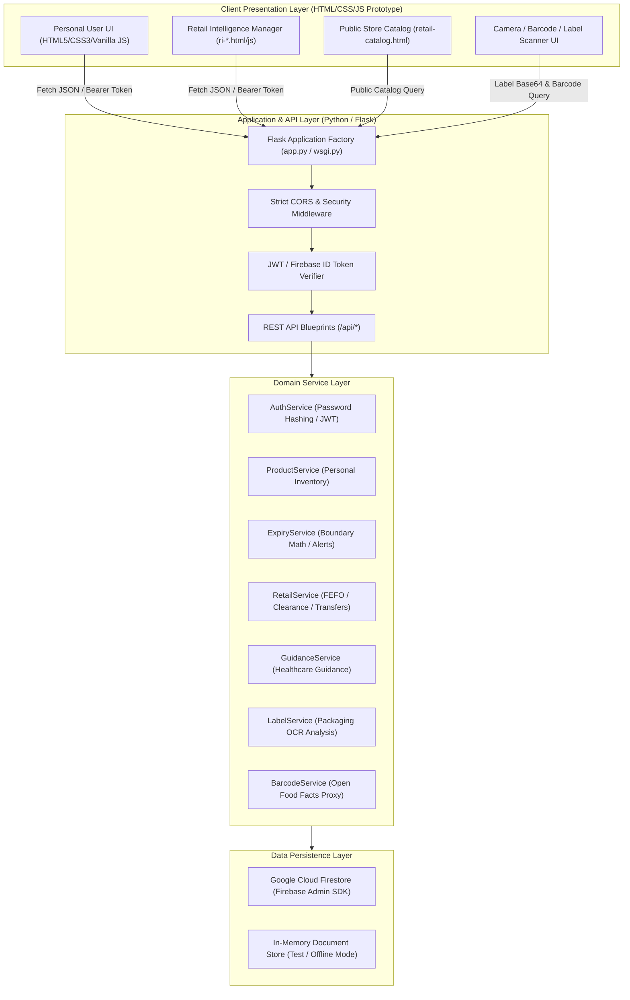

# ExpiryCare System Architecture

## 1. System Overview

**ExpiryCare — Smart Expiry Tracker & Healthcare Website** is a student prototype combining personal inventory shelf-life tracking, medical and food safety guidance, OCR label intelligence, barcode lookup, and multi-branch retail inventory management with FEFO (First Expired, First Out) optimization.

---

## 2. Layered Architecture

### A. Presentation Layer (`frontend/`)
- Pure HTML5, CSS3, and vanilla JavaScript without external build steps or heavyweight frameworks.
- Two frontend files were intentionally adjusted for API routing and chatbot messaging. Product/account/retail records remain in browser `localStorage`.
- The chatbot and label-analysis workflows communicate with the backend via REST JSON APIs. Not all inventory/account/retail CRUD flows are wired to backend endpoints yet.

### B. Gateway & Middleware Layer (`backend/middleware/`)
- **Application Factory**: `create_app()` initializes Flask, registers blueprints, and mounts CORS headers.
- **Dual Authentication Middleware**:
  - Validates HMAC-SHA256 JWT tokens for REST API clients.
  - Validates Google Firebase ID tokens via the Firebase Admin SDK.
  - Enforces strict user isolation: each authenticated user can access only their own records.
- **Centralized Error Handlers**:
  - Consistent JSON error payloads for HTTP 400, 401, 403, 404, 405, 413, 429, 500, 501, 503.
  - Hides internal stack traces and secrets from public consumers.

### C. Domain Service Layer (`backend/services/`)
- **`ExpiryService`**: Implements exact expiry calculations and status classifications without off-by-one errors across yesterday, today, tomorrow, and boundary days.
- **`ProductService`**: Validates product fields, manages CRUD, enriches items with live expiry status, and manages demo data seeding.
- **`AuthService`**: Manages salted password hashing (PBKDF2-SHA256), token issuance, profile updates, and settings.
- **`RetailService`**: Handles multi-branch retail inventory, verified FEFO prioritization, explainable clearance rules, and atomic transfer lifecycle state transitions.
- **`GuidanceService`**: Handles healthcare guidance queries, attaching mandatory medical disclaimers and falling back cleanly when external AI providers are unconfigured.
- **`LabelService`**: Validates image data URLs, inspects packaging, and interfaces with OCR/Vision models.
- **`BarcodeService`**: Queries Open Food Facts API with resilient error handling and timeouts.

### D. Repository & Persistence Layer (`backend/repositories/` & `backend/extensions.py`)
- A repository layer for **Google Cloud Firestore** using the `firebase-admin` server SDK is included.
- Dual-mode architecture:
  - When `FIRESTORE_ENABLED=true` and credentials are supplied, operates directly against Google Cloud Firestore.
  - When credentials are not configured, uses a non-persistent in-memory development store; data is lost when the backend process restarts.
- Complete Firestore Security Rules (`firebase/firestore.rules`) and Composite Indexes (`firebase/firestore.indexes.json`).
