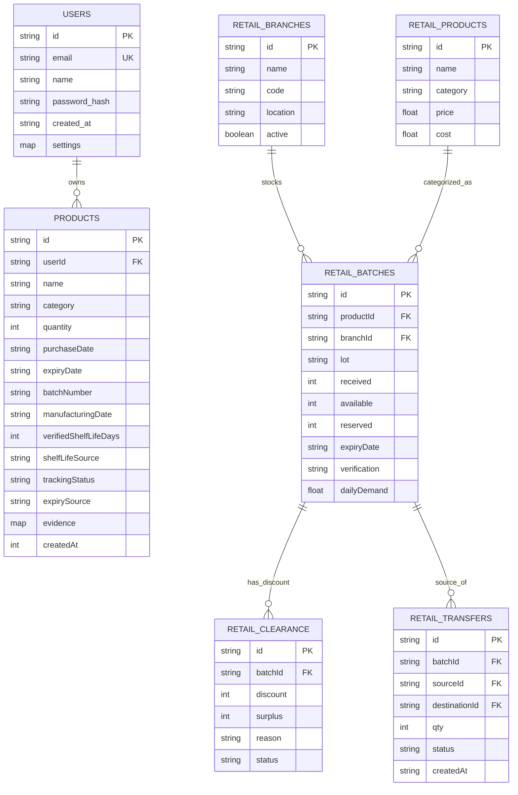

# ExpiryCare Firestore Database Schema

This document details the document structures, data types, relationships, and indexing requirements for Google Cloud Firestore.

---

## 1. Entity-Relationship Overview

---

## 2. Collection Definitions

### 2.1 Collection: `users`
- **Purpose**: Stores registered user accounts, salted password hashes, and notification preferences.
- **Document ID**: `user_<random_hex>` or Firebase UID.
- **Fields**:
  - `id` (String): Unique user identifier.
  - `email` (String, Indexed): User's lowercase email address.
  - `name` (String): Full name.
  - `password_hash` (String): Salted PBKDF2-SHA256 password hash.
  - `settings` (Map):
    - `alertThresholds` (Array of Numbers): Days before expiry to trigger alert (e.g. `[1, 3, 7]`).
    - `defaultSort` (String): Preferred inventory sort order (`expiry-date`, `name`, `date-added`).
  - `created_at` (String, ISO 8601): Timestamp of account creation.
  - `updated_at` (String, ISO 8601): Timestamp of last profile update.

### 2.2 Collection: `products`
- **Purpose**: Stores personal inventory records for each user.
- **Document ID**: `product_<timestamp>`
- **Fields**:
  - `id` (String): Unique product identifier.
  - `userId` (String, Indexed): Owner's user ID. Enforces multi-tenant data isolation.
  - `name` (String): Product trade or generic name.
  - `category` (String, Indexed): `medicine` | `grocery` | `personal-care` | `other`.
  - `quantity` (Integer): Count of units in stock (>= 1).
  - `purchaseDate` (String): Optional purchase date formatted as `YYYY-MM-DD`.
  - `expiryDate` (String, Indexed): Optional expiry date formatted as `YYYY-MM-DD`.
  - `manufacturingDate` (String): Optional manufacturing date formatted as `YYYY-MM-DD`.
  - `verifiedShelfLifeDays` (Integer, Nullable): Whole number shelf-life used for estimation.
  - `shelfLifeSource` (String): Source reference for estimated shelf life.
  - `batchNumber` (String): Lot or batch code from packaging.
  - `barcode` (String): Barcode number if scanned or manually entered.
  - `notes` (String): User's personal storage notes or dosage reminders.
  - `expirySource` (String): `user-confirmed` | `estimated` | `unknown`.
  - `trackingStatus` (String): `verified-expiry` | `estimated-expiry` | `expiry-unknown` | `unidentified`.
  - `evidence` (Map): Details verifying identity, barcode source, and shelf life basis.
  - `createdAt` (Integer): Milliseconds epoch timestamp.
  - `updatedAt` (Integer): Milliseconds epoch timestamp.

### 2.3 Collection: `retail_branches`
- **Document ID**: `br-<store_code>`
- **Fields**:
  - `id` (String): Unique branch code (e.g. `br-a`).
  - `name` (String): Store name (e.g. `Store A`).
  - `code` (String): Branch code (e.g. `A-101`).
  - `location` (String): Geographic location.
  - `active` (Boolean): Operational status.

### 2.4 Collection: `retail_batches`
- **Document ID**: `ba-<product_code>-<branch_code>`
- **Fields**:
  - `id` (String): Lot identifier.
  - `productId` (String, Indexed): Reference to retail product.
  - `branchId` (String, Indexed): Store location storing the lot.
  - `lot` (String): Physical batch code (e.g. `ML-A1`).
  - `received` (Integer): Total units originally received into stock.
  - `available` (Integer): Total physical units currently on hand.
  - `reserved` (Integer): Units locked for approved pending transfers.
  - `expiryDate` (String, Nullable, Indexed): Expiry date `YYYY-MM-DD`.
  - `verification` (String): `Verified` | `Needs Verification`.
  - `dailyDemand` (Float): Synthetic daily consumption rate.
  - `demandSource` (String): Source methodology note.

### 2.5 Collection: `retail_clearance`
- **Document ID**: `cl-<batchId>`
- **Fields**:
  - `id` (String): Clearance record ID.
  - `batchId` (String): Associated batch.
  - `discount` (Integer): Recommended discount percentage (15% or 25%).
  - `surplus` (Integer): Estimated units exceeding demand before expiration.
  - `reason` (String): Explainable business rule rationale.
  - `status` (String): `Suggested` | `Approved` | `Rejected`.
  - `createdAt` (String): ISO timestamp.

### 2.6 Collection: `retail_transfers`
- **Document ID**: `tr-<timestamp>`
- **Fields**:
  - `id` (String): Transfer workflow identifier.
  - `batchId` (String, Indexed): Source batch.
  - `productId` (String): Product type.
  - `sourceId` (String): Originating branch.
  - `destinationId` (String): Target branch.
  - `qty` (Integer): Requested transfer units.
  - `status` (String, Indexed): `Requested` | `Approved` | `Dispatched` | `Received` | `Completed` | `Cancelled` | `Rejected`.
  - `createdAt` (String): ISO timestamp.
  - `history` (Array of Maps): Audit trail of lifecycle status changes with timestamps.
